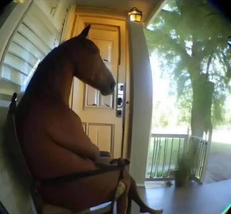

# ☕ My Java Journey

Привет! Я начинающий Java-разработчик. Изучаю Java и постепенно погружаюсь в мир Backend-разработки.

### 🛠 Что изучаю
- Java Core
- ООП и работа с классами и объектами
- Методы, циклы и условия
- Алгоритмы и решение практических задач
- Написание чистого и понятного кода

### 🚀 Мои цели
- Освоить Spring Boot и SQL
- Научиться создавать REST API
- Разработать собственные проекты
- Получить первый опыт работы Java Developer

### 🎯 Немного обо мне
Люблю разбираться, как всё устроено, решать задачи и находить решения. Не боюсь ошибок — воспринимаю их как часть обучения.

**Главная цель — превратить Java из учебного интереса в профессию!**

